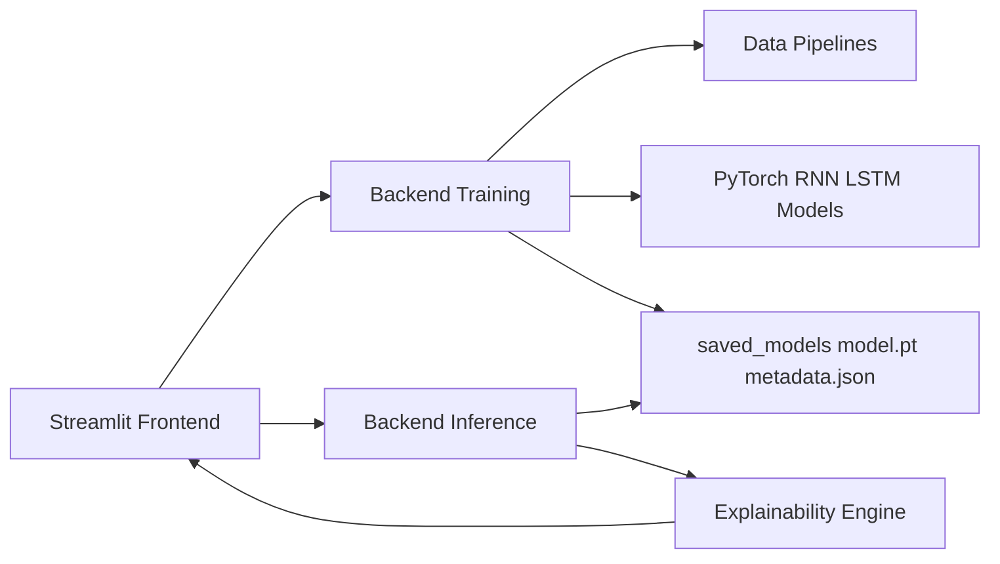

# RNN/LSTM Training and Inference UI

PyTorch + Streamlit application for two sequence-learning tasks:

1. **Text generation** using `alice_in_wonderland.txt`
2. **Movie review classification** using IMDB sentiment data

The UI has four tabs for training/inference workflows and includes per-token explainability.

---

## Features

- Train either **RNN** or **LSTM** for both tasks
- Configure hyperparameters from UI (epochs, LR, hidden size, sequence length, etc.)
- Track and persist **train/val loss + accuracy** per epoch
- Save models with metadata (`model.pt` + `metadata.json`)
- Run inference using saved models
- Inspect explainability:
  - Gradient Influence
  - Information Flow Heatmap
  - Hidden State Delta Projection (signed token contribution)
  - Cumulative Confidence Curve
  - Input x Gradient token scores

---

## Project Structure

```text
rnn_visualisation/
├── backend/
│   ├── models/                 # RNN/LSTM model definitions
│   ├── data/                   # Text + IMDB preprocessing and dataloaders
│   ├── training/               # Training loops + model persistence
│   ├── inference/              # Saved model loading + inference logic
│   └── explainability/         # Token-level explainability methods
├── frontend/
│   ├── app.py                  # Streamlit entrypoint (4 tabs)
│   ├── tabs/                   # Per-tab UI logic
│   └── components/             # Shared Plotly chart components
├── saved_models/               # Saved training runs
├── alice_in_wonderland.txt     # Text corpus for generation
├── README.md
└── Explainability.md
```

---

## Architecture



---

## Tech Stack

- **Frontend:** Streamlit, Plotly
- **Backend ML:** PyTorch
- **Data:** HuggingFace `datasets` (IMDB)
- **Utilities:** NumPy, tqdm

---

## Setup

### 1) Create and activate environment

```bash
python -m venv .venv
source .venv/bin/activate
```

### 2) Install dependencies

```bash
pip install -r requirements.txt
```

### 3) Verify local corpus

Ensure `alice_in_wonderland.txt` exists in project root.

---

## Run the App

From project root:

```bash
streamlit run frontend/app.py
```

---

## Tab-by-Tab Walkthrough

## 1) Training text gen

- Select model: RNN or LSTM
- Set training hyperparameters
- Start training and monitor:
  - Train/Val Loss
  - Train/Val Accuracy
- Metrics are shown live and persisted in session + metadata
- Model is saved to `saved_models/text_gen_*`

## 2) Inference text gen

- Select any saved text-generation model
- Provide seed phrase + generation length (+ temperature/top-k)
- Generate text
- Inspect explainability for each generated step:
  - Gradient Influence
  - Information Flow heatmap
  - Signed token contribution (Hidden State Delta Projection)
  - Cumulative confidence
  - Input x Gradient

## 3) Training movie review classification

- Select model: RNN or LSTM
- Train on IMDB with exact **70-20-10 split**
  - 70% train
  - 20% validation
  - 10% test
- Track train/val loss + accuracy per epoch
- Save trained model to `saved_models/movie_cls_*`

## 4) Inference

- Choose saved classifier model
- Inference input options:
  - Pick sample from test split
  - Enter custom review
- View predicted sentiment + confidence
- View token-level explainability charts

---

## Model Persistence

Each saved run has:

- `model.pt`: model weights
- `metadata.json`:
  - task and model type
  - hyperparameters
  - vocab mappings
  - split sizes
  - full epoch history (`train_loss`, `val_loss`, `train_accuracy`, `val_accuracy`)

---

## Notes

- The IMDB dataset is downloaded automatically by `datasets` on first use.
- First movie-model training may take longer due to download + preprocessing.
- Explainability for long sequences can be compute-heavy; reduce sequence length for faster interaction.

---

## Screenshot Placeholders

- Add `docs/screenshots/tab1_training_text.png`
- Add `docs/screenshots/tab2_inference_text.png`
- Add `docs/screenshots/tab3_training_movie.png`
- Add `docs/screenshots/tab4_inference_movie.png`

---

## Troubleshooting

- If Streamlit cannot import modules, run app from project root.
- If CUDA is unavailable, training falls back to CPU automatically.
- If no models appear in inference tabs, train and save a model first.

